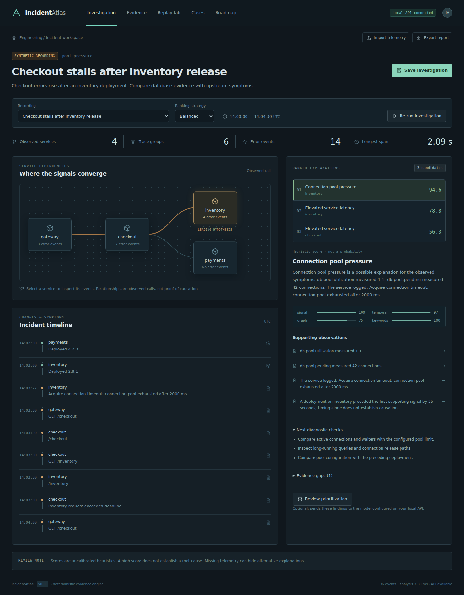
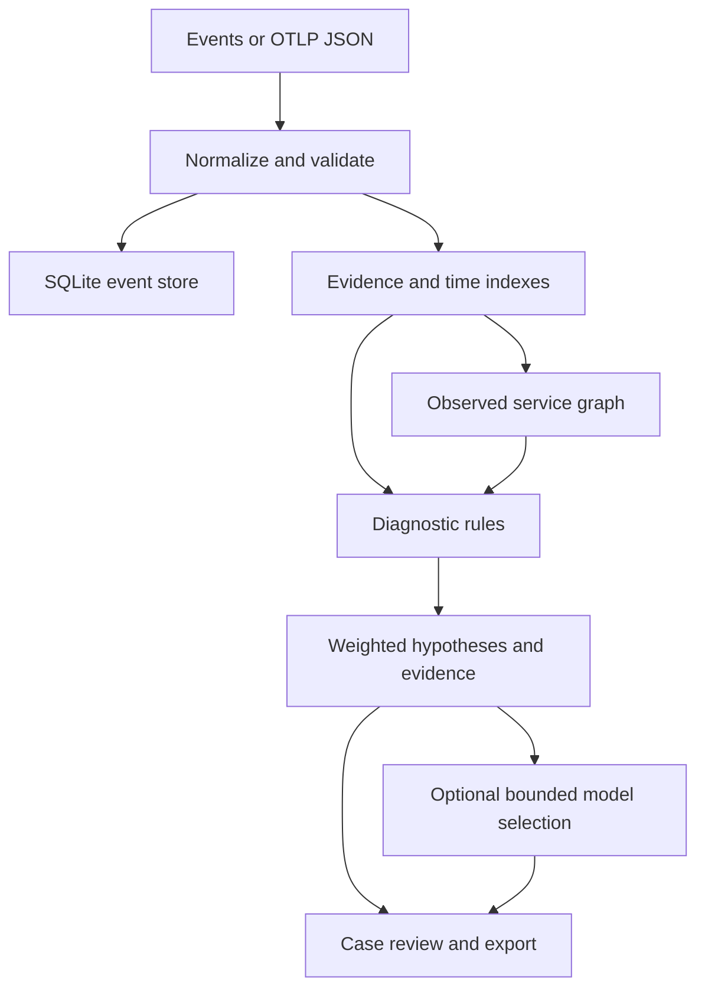

# IncidentAtlas

**An incident explanation is useful only when you can inspect the evidence.**

IncidentAtlas is a local investigation workspace for distributed application failures. It normalizes telemetry, reconstructs service dependencies and timelines, ranks supported explanations, and shows the observations behind each finding. Cases can be saved, annotated, replayed with different strategies, and exported.

The core works without a hosted model. An optional model can prioritize existing hypotheses; it cannot insert new facts into the displayed evidence.



## Start locally

Requires **Python 3.10+**. The core, CLI, SQLite storage, and reference HTTP server use the standard library. Run from the project root:

```bash
python -m incidentatlas serve --port 8100
```

Open **http://127.0.0.1:8100**. The interface connects to the local API and restores saved SQLite cases, including their notes and review status. The supplied browser bundle is ready to use. If you change the interface or browser engine, rebuild it with Node.js 24+:

```bash
npm ci
npm run build:web
```

For the optional FastAPI transport and all API tests:

```bash
python -m venv .venv
source .venv/bin/activate
pip install -r requirements.txt
python -m incidentatlas serve --fastapi --port 8100
```

On Windows PowerShell, activate with `.venv\Scripts\Activate.ps1`; `python` must refer to your installed Python 3.10+ interpreter.

For Docker:

```bash
docker compose up --build
```

Compose publishes only to the host's loopback address and retains SQLite data in a named volume.

## The working core

| Capability | What v0.1 actually does |
| --- | --- |
| Ingestion | Accepts normalized event JSON and a documented subset of OTLP JSON spans, logs, and metrics. |
| Input handling | Normalizes timestamps, rejects invalid values, detects duplicate/conflicting IDs, and retains flagged late arrivals. |
| Service map | Derives observed dependencies from peer-service attributes and cross-service span relationships. |
| Investigation | Combines rule-based signals, nearby deployments, graph propagation, and keywords into explainable heuristic scores. |
| Evidence review | Shows supporting observations, contradicting observations, missing evidence, diagnostic checks, and a request waterfall drawn from recorded spans. |
| Replay | Runs the same incident through balanced, temporal, graph, or keyword weighting. |
| Cases | Saves and reloads analyses, notes, and review status through the connected SQLite API. Browser-only cases use localStorage. The interface exports JSON; the API also exports Markdown. |
| Evaluation | Compares rankings with separate labels across four synthetic failure scenarios and two controls. |
| Optional model | Selects from existing hypothesis IDs; validated output renders deterministic evidence-linked explanations. |

The four supported diagnostic families are connection-pool pressure, downstream latency, retry amplification, and configuration validation failure. These are explicit rules, not a general causal model.

## A five-minute investigation

1. Open the **Pool pressure** scenario.
2. Read the timeline and follow checkout's observed dependencies.
3. Select the leading hypothesis to inspect pool metrics, timeout logs, and deployment timing.
4. Review contradictory observations and missing evidence before accepting the explanation.
5. Compare the graph and temporal weighting strategies.
6. Open **Evidence** and inspect the **Request waterfall**; click a span to inspect its timing and parent reference.
7. Save a case, add a reviewer note, change its status, and reload the page to confirm persistence. Export the case as JSON, or use the API for Markdown.
8. Open the healthy and sparse controls to see the system abstain when supported diagnostic evidence is absent.
9. If you configured a provider, click **Review prioritization** to select among existing explanations.

All bundled incidents are **synthetic fixtures**. The release includes recorded telemetry, not a live fault-injection microservice environment. See the [investigation walkthrough](docs/investigation-walkthrough.md).

## CLI and verification

```bash
python -m incidentatlas analyze --scenario pool-pressure --strategy balanced --output report.json
python -m incidentatlas evaluate
python -m incidentatlas benchmark --size 10000 --repeats 20
python -m unittest discover -s tests -v
node browser/test-parity.mjs
```

For custom supported events:

```bash
python -m incidentatlas analyze --input my-events.json --output report.json
```

The input can be an event array, `{ "events": [...] }`, or the documented OTLP JSON subset. The browser importer accepts normalized events only; use the Python path for OTLP JSON. Browser/Python parity checks cover supplied fixtures and selected missing/invalid-data cases. Tests needing FastAPI/httpx skip if optional dependencies are absent; install `requirements.txt` to run them. No real provider call is required for the test suite.

## Architecture



- `incidentatlas/`: normalization, indexes, graph, ranking, persistence, transports, CLI, model boundary.
- `browser/`: browser implementation for local interactive fixture analysis.
- `web/`: interface and bundled assets.
- `fixtures/`: synthetic scenarios, separate evaluation labels, generated demo results, and recorded measurements.
- `tests/`: diagnostic, ingestion, storage, API, and model-boundary checks.

The interface computes its interactive investigations with the browser engine. When the Python API is connected, case creation, notes, and status changes persist in SQLite, and saved cases reload on startup. **SQLite** and **Browser** labels identify each case's storage. Without the API, localStorage keeps browser-only cases; those cases are not automatically imported into SQLite. Optional model review always goes through the configured local API.

## API

With the server running, exercise the full saved-case flow:

```bash
python scripts/api-demo.py
```

| Method | Route | Purpose |
| --- | --- | --- |
| GET | `/api/health` | Local server/storage status. |
| GET | `/api/scenarios` | List bundled synthetic scenarios. |
| GET | `/api/scenarios/{id}` | Read a scenario and its events. |
| POST | `/api/ingest?workspace=demo` | Ingest `{events:[...]}` or supported OTLP JSON. |
| GET | `/api/events?workspace=demo` | Read normalized persisted events. |
| POST | `/api/analyze` | Analyze a scenario, supplied events, or a persisted workspace. |
| POST | `/api/evaluate` | Evaluate a ranking strategy against synthetic labels. |
| POST | `/api/cases` | Save `{title, analysis, scenario_id?}`. |
| GET | `/api/cases` | List saved cases. |
| GET/PATCH | `/api/cases/{id}` | Read, annotate, or change review status. |
| GET | `/api/cases/{id}/export?format=markdown` | Export a report; `json` is also supported. |
| POST | `/api/explain` | Select an explanation with the optional model boundary. |

Analysis accepts `{ "scenario_id": "pool-pressure", "strategy": "balanced" }` or `{ "events": [...], "strategy": "graph" }`. Supported strategies are `balanced`, `temporal`, `graph`, and `keyword`.

## Optional model configuration

Set these on the **server**, never in browser code:

| Variable | Meaning |
| --- | --- |
| `INCIDENTATLAS_LLM_URL` | Full compatible chat-completions endpoint URL; HTTPS required except loopback HTTP. |
| `INCIDENTATLAS_LLM_MODEL` | Model identifier accepted by your endpoint. |
| `INCIDENTATLAS_LLM_API_KEY` | Optional bearer token when the endpoint requires it. |

No model runs unless configured. The model receives candidate IDs and their evidence summaries; consider whether your provider is allowed to receive those observations. Output must contain only one to three existing hypothesis IDs. Unknown IDs, extra fields, malformed responses, timeouts, and network failures fall back to the deterministic explanation. The model does not execute runbooks or change infrastructure.

## Boundaries that matter

- Scores are **uncalibrated heuristics**, not probabilities or proof of causality. A recent deployment is supporting context, not proof that it caused the incident.
- Six small fixtures guide rule development. Their evaluation is regression coverage, not held-out accuracy or evidence of generalization to production incidents.
- Evidence-ID validity means references exist. It does not prove that the conclusion drawn from them is correct.
- The OTLP adapter supports JSON inputs only, with gauge/sum number points and a histogram mean/count representation. It does not implement an OTLP gRPC receiver, exponential histograms, inferred p95, or complete Collector compatibility.
- Storage is SQLite. ClickHouse, PostgreSQL, retention management, live collectors, and cluster ingestion remain future integrations.
- Input batches are limited to 100,000 events and HTTP bodies to 5 MiB. Analysis is in-memory and bounded for local use, not a high-volume stream processor.
- Clock-skew attributes produce uncertainty warnings. The engine does not reconstruct corrected clocks.
- Local endpoints have no authentication or tenant isolation. See [SECURITY.md](SECURITY.md).

## Continue the project

[Architecture and algorithms](docs/architecture.md) · [Benchmark and evaluation method](docs/benchmarking.md) · [Roadmap and PR tickets](docs/roadmap.md) · [Contributing](CONTRIBUTING.md)

“70%” is a planning target for an agreed roadmap. This repository does not claim a measured completion percentage, production readiness, or any fabricated development duration.

MIT licensed. See [LICENSE](LICENSE).
